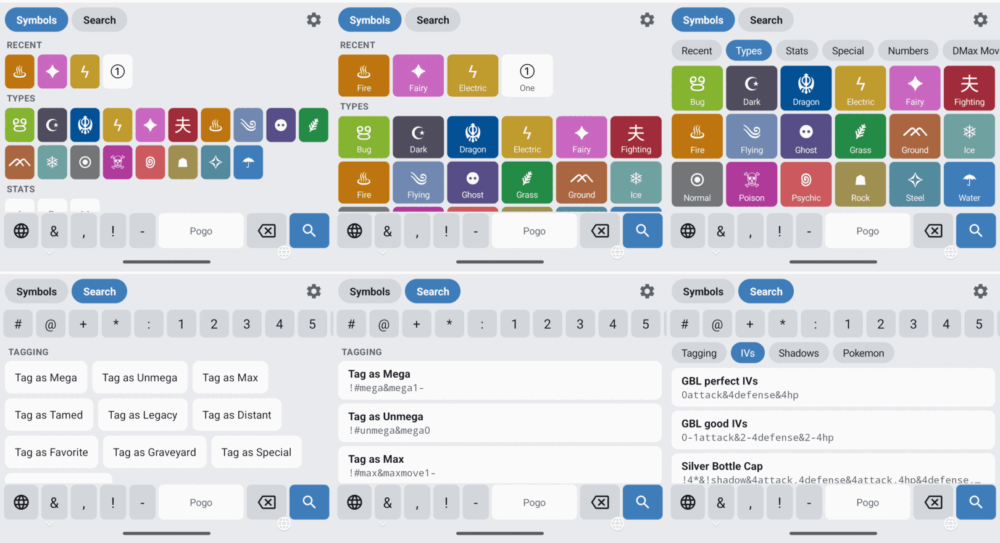

# Pogo Keyboard (Android)

A native Android keyboard (`InputMethodService`) that puts Pogo Paste's symbols and search strings
one tap away from your normal keyboard. No copy/paste, no browser.

* **Tiny and boring on purpose.** Kotlin with platform Views only: no AndroidX, no Compose, no
  third-party libraries. About 60 KB release APK, **zero permissions**, no network access.
* **One source of truth.** `src/_data/symbols.json` and `src/_data/search.json` (the website's data)
  are bundled as assets at build time, so editing the site's data updates the keyboard too.

## Install (sideload)

```bash
cd android
./gradlew assembleDebug                      # or assembleRelease (see Signing)
adb install -r app/build/outputs/apk/debug/app-debug.apk
```

Then open **Pogo Keyboard** from the launcher and follow the two setup steps: turn it on, then
make it the current keyboard. Debug builds install as `app.pogopaste.keyboard.debug`, so they can
sit next to a release build.

No `adb`? Copy the APK to the phone and open it. Android will ask you to allow installs from that
app (Files, Drive, …) once.

## Using it

| Where       | What                                                                                     |
| ----------- | ---------------------------------------------------------------------------------------- |
| Top bar     | **Symbols** / **Search** tabs. Press a key to see its name here. ⚙ opens settings.      |
| Symbols     | Tap to insert. **Hold** a key to show its alternates (Psychic has 8), then slide up onto one and lift, or tap one. |
| Search      | Tap a string to insert it. Long-press to read the whole string. Top strip: `# @ + * :` and digits. |
| Bottom row  | 🌐 back to your keyboard · `& , ! -` · space · ⌫ (hold to repeat) · Enter/Search        |

**Combining search strings:** with "Combine search strings with &" on (the default), tapping a
second search string adds `&` first. In Pokémon GO `&` binds loosest, so `a,b&c,d` reads as
"(a or b) and (c or d)", and joining two whole strings always means "both".

### Switching with Gboard (the fast path)

* **Gboard → Pogo:**
  * **Android 13+ with gesture nav:** tap the ⌨/🌐 switcher in the navigation bar, under the
    keyboard's bottom-right corner. One tap cycles straight to Pogo.
  * **3-button nav:** tap the keyboard icon in the nav bar.
  * **Gboard's globe key:** Gboard settings › Preferences › *Show language switch key*.
* **Pogo → Gboard:** tap 🌐 (bottom-left). It returns to whichever keyboard you came from.
  Long-press 🌐 or the space bar to open the full keyboard picker.
* **Hands-free return:** Settings › *After inserting, return to the previous keyboard* ›
  *After a search string* (or *After any symbol*). The flow becomes Gboard → Pogo → tap →
  back on Gboard automatically.

## Layouts

Pick one in Settings › Layout. Each applies to both tabs.



| Layout           | Symbols                                                                      | Search strings                                  |
| ---------------- | ---------------------------------------------------------------------------- | ----------------------------------------------- |
| **Compact grid** | Every group in one dense scrolling grid (~9 keys per row). Names on press.   | Name chips that wrap. Most strings on screen.   |
| **Captioned**    | Larger keys (6 per row) with the description under each glyph, like the site. | Rows with the name plus a preview of the string. |
| **Paged groups** | Chip row (Recent · Mine · Types · Stats · …); keys stretch to fill the page. All 18 types fit without scrolling. | Chip row per group, rows below. |

Keyboard height is adjustable (140–360 dp). It is capped at about 55% of the screen, so landscape
stays usable.

## Make it yours (Settings ⚙)

* **Your symbols:** one per line, the symbol then an optional name (`✨ Shiny`). Several bare
  symbols on one line add them all (`★ ☆ ✪`). They appear first, as **Mine**.
* **Your search strings:** `Name | string`, one per line, also shown first as **Mine**.
* **Groups:** hide any built-in symbol or search group.
* Haptics, recents row, auto-return, and `&` joining all have toggles.

Settings and custom entries are included in Android backup and device-to-device transfer.

## Development

```bash
./gradlew :app:testDebugUnitTest   # JVM + Robolectric tests (API 24, 28, 35)
./gradlew :app:lintDebug
./gradlew :app:assembleRelease     # R8-minified, resources shrunk
```

| File                     | Role                                                                                          |
| ------------------------ | --------------------------------------------------------------------------------------------- |
| `PogoImeService.kt`      | The IME: builds the view, commits text, delete/enter semantics, keyboard switching.           |
| `PogoKeyboardView.kt`    | The whole keyboard surface, built in code: top bar, tabs, layouts, bottom row.               |
| `KeyGridView.kt`         | Canvas-drawn symbol grid (one View for ~70 keys) with TalkBack virtual nodes.                 |
| `Catalog.kt`             | Parses the site JSON plus user entries; grapheme-safe splitting. Tolerates malformed data.  |
| `Prefs.kt`               | Typed SharedPreferences.                                                                      |
| `SettingsActivity.kt`    | Setup + settings screen (platform widgets, no AppCompat).                                     |

### Signing a release

Create `android/keystore.properties` (gitignored):

```properties
storeFile=/absolute/path/to/pogo.jks
storePassword=…
keyAlias=pogo
keyPassword=…
```

Without it, `assembleRelease` signs with the debug key. That's fine for sideloading, but not
for the Play Store.
